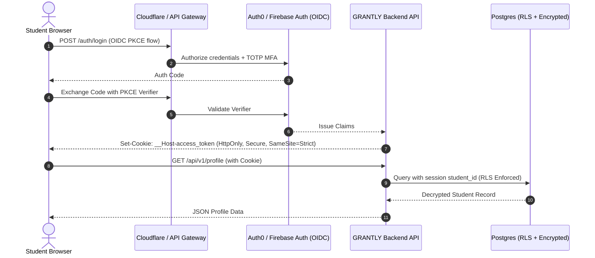
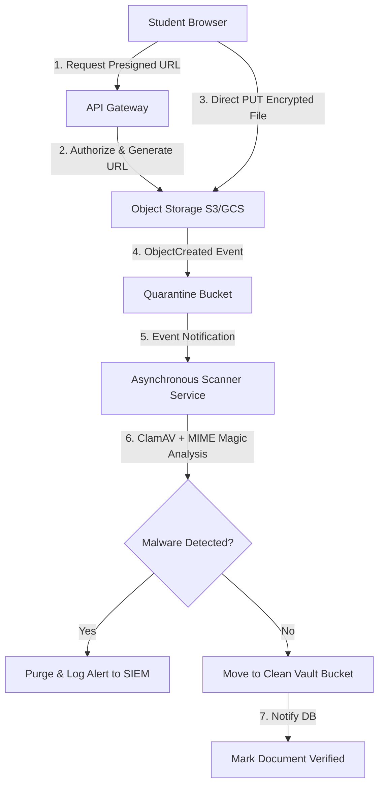

# GRANTLY — Future Backend Security & Production Architecture Blueprint

**Document Version:** 1.0.0  
**Date:** November 7, 2026  
**Target Audience:** Cloud Architects, Security Engineers, Lead Developers  
**Scope:** Engineering specification for migrating GRANTLY from a client-side prototype to a compliant, enterprise-grade cloud service  

---

## 1. Executive Vision

GRANTLY's prototype demonstrates client-side scholarship evaluation and application workflow tracking. To transition to a multi-tenant, cloud-backed platform handling sensitive student data (academic transcripts, caste/minority certificates, annual family income proofs), a zero-trust backend architecture is mandatory.

This document serves as the formal engineering blueprint for backend security, data sovereignty, identity federation, and regulatory compliance.

---

## 2. Identity, Authentication & Session Lifecycle



### 2.1 Identity Standards:
1. **OAuth 2.1 / OIDC:**
   - Authorization Code Flow with **PKCE (Proof Key for Code Exchange)** mandatory for all web and mobile clients.
   - Prohibit implicit grant and resource-owner password credential flows.
2. **Multi-Factor Authentication (MFA):**
   - Mandatory TOTP or WebAuthn / Passkeys for institutional administrators and counselors.
   - Opt-in SMS/Email OTP or Passkeys for students.
3. **Session Cookie Security:**
   - Tokens must **NEVER** be stored in `localStorage` or `sessionStorage` in the production cloud architecture.
   - Auth tokens must be issued as `__Host-` prefixed cookies:
     ```http
     Set-Cookie: __Host-grantly_session=eyJhbGciOi...; Path=/; Secure; HttpOnly; SameSite=Strict; Max-Age=3600
     ```
   - Refresh tokens stored in encrypted server-side Redis with rotation on every exchange.

---

## 3. Database Security & Field-Level Encryption (FLE)

### 3.1 Row-Level Security (RLS) in PostgreSQL:
To prevent horizontal privilege escalation (IDOR vulnerabilities where Student A queries Student B's applications):

```sql
-- Enable RLS on core student tables
ALTER TABLE student_profiles ENABLE ROW LEVEL SECURITY;
ALTER TABLE applications ENABLE ROW LEVEL SECURITY;
ALTER TABLE uploaded_documents ENABLE ROW LEVEL SECURITY;

-- Enforce strict tenant boundary per authenticated student UUID
CREATE POLICY student_profile_isolation ON student_profiles
  FOR ALL
  TO authenticated
  USING (student_id = current_setting('request.jwt.claim.sub', true)::uuid);

CREATE POLICY student_applications_isolation ON applications
  FOR ALL
  TO authenticated
  USING (student_id = current_setting('request.jwt.claim.sub', true)::uuid);
```

### 3.2 Field-Level Encryption (Envelope Encryption with AWS KMS / GCP Cloud KMS):
Sensitive student fields must be encrypted before writing to persistent storage disks:

| Field Name | Classification | Encryption Scheme | Key Type |
| :--- | :--- | :--- | :--- |
| `annual_family_income` | Financial / Means | AES-256-GCM (Envelope) | Customer Managed Key (CMK) |
| `social_category` | Affirmative Diversity | AES-256-GCM (Deterministic index for filtering) | Regional HSM Key |
| `disability_certificate_no` | Sensitive Health / PwD | AES-256-GCM | CMK with Hardware Key Rotation |
| `bank_account_number` | Disbursement Data | AES-256-GCM (Tokenized via Payment Gateway) | Dedicated Vault Key |

---

## 4. Document Vault & File Upload Security

The prototype simulates a student document vault (`/vault`). In production, handling PDFs and scanned certificates presents significant malware, arbitrary file execution, and exfiltration vectors.



### 4.1 Strict Upload Controls:
1. **Presigned Upload URLs:** Client uploads directly to cloud storage; API servers never buffer multi-megabyte payloads in memory.
2. **Content-Type & Magic Byte Validation:** Validate file magic numbers (e.g., `%PDF-1.`) via an asynchronous processing worker rather than trusting client-supplied MIME headers.
3. **Malware & Virus Scanning:** Every document is initially stored in a segregated quarantine bucket and scanned with ClamAV / VirusTotal API before promotion to the clean vault.
4. **Content-Disposition Enforcement:** Stored objects must be served with:
   ```http
   Content-Disposition: attachment; filename="verified-document.pdf"
   Content-Security-Policy: sandbox
   ```
   This prevents SVG or HTML files from executing scripts within the browser's context.

---

## 5. API Gateway & Threat Protection

1. **Rate Limiting & Anti-Scraping:**
   - Enforce IP-based and token-based rate limits (e.g., 60 requests/minute per authenticated user, 10 requests/minute for anonymous catalog search).
2. **Schema Validation:**
   - Enforce OpenAPI / JSON Schema validation at the gateway boundary. Requests with unmapped fields must be rejected (defense against mass-assignment vulnerabilities).
3. **Audit Logging (Immutable Trail):**
   - Every mutation (application submission, profile update, data export, document download) must emit an immutable log event to an append-only store (AWS CloudWatch / GCP Cloud Logging / Datadog).
   - Log schema:
     ```json
     {
       "timestamp": "2026-11-07T14:30:00Z",
       "actor_id": "usr_9981a8c2",
       "action": "DOCUMENT_VIEWED",
       "resource_id": "doc_income_cert_2026",
       "ip_hash": "e3b0c44298fc1c149afbf4c8996fb92427ae41e4649b934ca495991b7852b855",
       "user_agent": "Mozilla/5.0..."
     }
     ```

---

## 6. Regulatory & Privacy Compliance Architecture

### 6.1 India Digital Personal Data Protection (DPDP) Act Compliance:
- **Consent Manager Integration:** Maintain verifiable, versioned consent records whenever students opt to share data with third-party scholarship boards.
- **Data Erasure Pipeline:** Asynchronous background worker (`DeleteStudentPipeline`) that cascades erasures across PostgreSQL, Object Storage, and audit backups within 72 hours of user request.
- **Data Localization:** Ensure all databases and storage buckets reside within designated Indian cloud regions (e.g., AWS `ap-south-1` Mumbai / GCP `asia-south1`).

### 6.2 FERPA & Student Privacy Compliance:
- Educational records must never be exposed to marketing aggregators.
- Directory information must be strictly opt-in.
